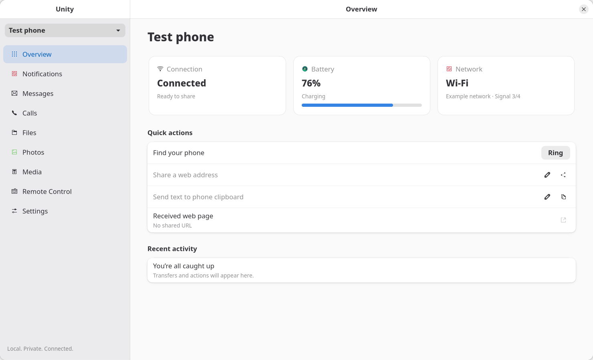
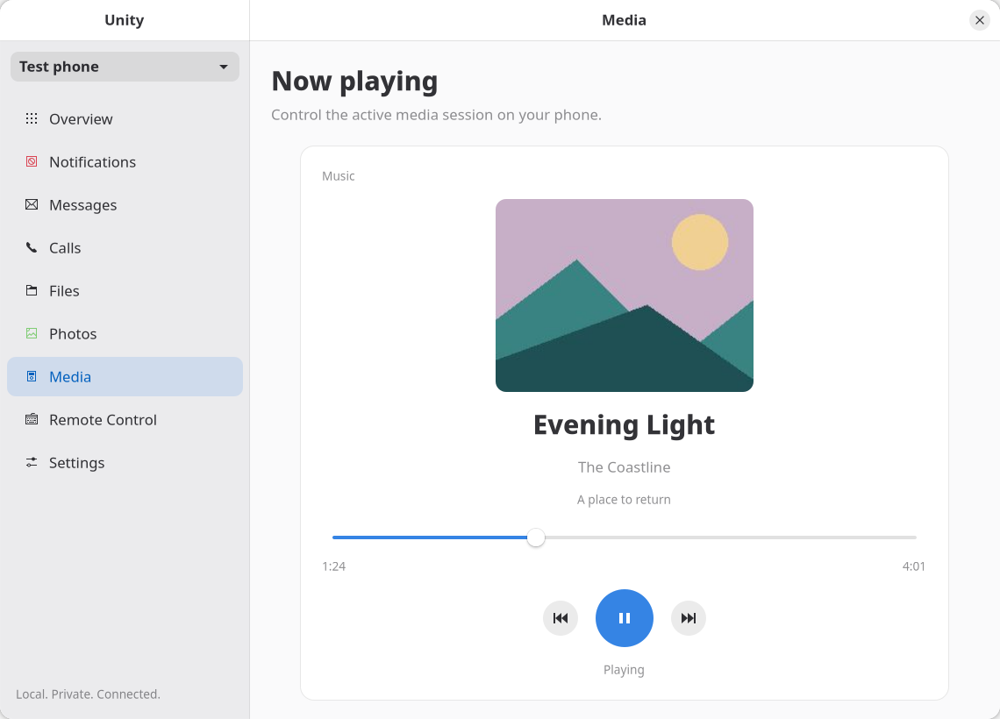
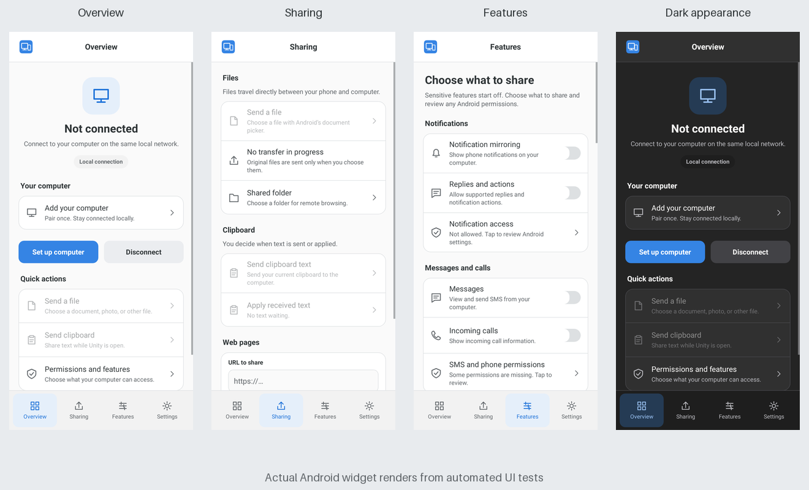

# Unity

Unity is a local-first companion platform with two independent projects. The Linux daemon provides the public D-Bus API; its GTK application and CLI are clients of that API. The Android companion communicates with the daemon over an authenticated local network connection.

| Project | Contents | Build guide |
| --- | --- | --- |
| [Unity_Linux](Unity_Linux/README.md) | Rust daemon, protocol, transports, D-Bus API, CLI, GTK frontend, systemd unit, and Linux tests | [Linux build](Unity_Linux/docs/build.md) |
| [Unity_Android](Unity_Android/README.md) | Kotlin companion, Android services, permission flows, UI, and Android tests | [Android build](Unity_Android/docs/build.md) |

Both projects can be built from their own directories. They share [wire protocol v1](Unity_Linux/docs/protocol.md); changing messages or capabilities requires coordinating both sides. The Linux daemon runs without either graphical client. See the [feature matrix](Unity_Linux/docs/features.md) for the distinction between implemented, partial, unsupported, and hardware-untested features.

## Linux app






These screenshots render the real GTK widgets with isolated test data. They do not show a live phone session.

## Android app



These screenshots render the production Android widgets in automated UI tests. No computer was paired in the screenshots.

## Get started

```sh
cd Unity_Linux
source scripts/env.sh
./scripts/build.sh
python3 scripts/install.py
systemctl --user daemon-reload
systemctl --user enable --now unityd.service

cd ../Unity_Android
source scripts/env.sh
./scripts/build.sh
```

Build the Android APK using the [Android build guide](Unity_Android/docs/build.md), then install it over an existing debug companion to retain pairing. On the phone, enter the computer's LAN address and the verified certificate fingerprint printed by `unityctl discover`. Review and approve the pending phone identity on the Linux computer. Follow each project's build guide for dependencies and the full setup procedure.

There is no mandatory account, external server, telemetry, or root daemon. Unity remains an early functional implementation with platform and permission limits documented in the [testing guide](Unity_Linux/docs/testing.md).
